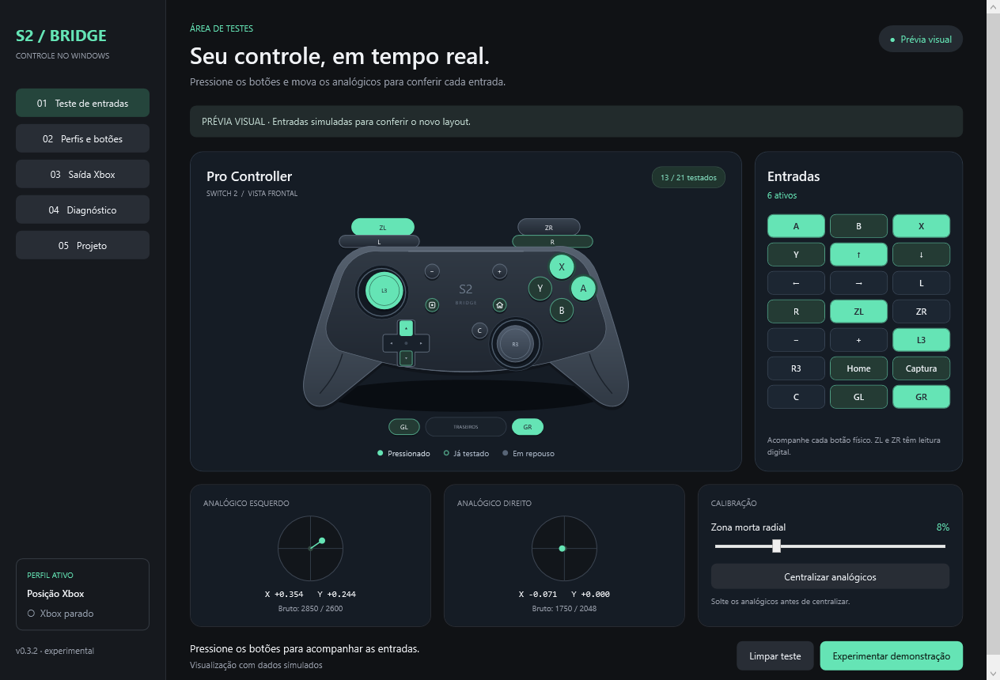

# Switch2Bridge

Use o **Nintendo Switch 2 Pro Controller por USB no Windows**, com teste de entradas, perfis e saída de controle Xbox 360 para jogos compatíveis com XInput.

Aplicativo independente em C# e WPF para Windows 10/11 x64 e .NET Framework 4.8. Versão atual: **0.3.2**. O suporte ainda é experimental; o projeto não tem vínculo com a Nintendo.



## Recursos

- Teste dos 21 botões e dos dois analógicos, com diagnóstico da conexão.
- Remapeamento para botões e gatilhos Xbox, incluindo C, Captura, GL e GR.
- Perfis XML com salvamento automático, cópia, importação e exportação.
- Zona morta, calibração de centro, inversão e troca dos analógicos.
- Saída Xbox 360 virtual por ViGEmBus, com neutralização após falta de dados.
- Mediana, p95 e p99 do tempo entre leitura HID e aceitação pelo driver.

Suporta um controle oficial identificado como `057E:2069`, conectado por cabo USB de dados. Bluetooth, vibração, giroscópio, ocultação do controle físico e seleção automática de perfil por jogo ainda não estão implementados. ZL e ZR são digitais no controle físico.

## Compilar e executar

No PowerShell, dentro da pasta do projeto:

```powershell
.\build.ps1 -Test
.\bin\Switch2Bridge.exe
```

O script usa o compilador x64 do .NET Framework instalado no Windows. Não requer Visual Studio, SDK do .NET ou pacotes NuGet. Se sua política local bloquear scripts, execute a compilação com `powershell -NoProfile -ExecutionPolicy Bypass -File .\build.ps1 -Test`; isso se aplica somente àquele processo.

O GitHub Actions também compila e executa os testes. Cada execução bem-sucedida disponibiliza o pacote `Switch2Bridge-windows-x64` nos artefatos da execução. Extraia o pacote para uma pasta em que sua conta possa gravar e abra `Switch2Bridge.exe`, mantendo o arquivo `.exe.config` ao lado dele.

Para continuar usando perfis de uma versão anterior, feche os aplicativos e copie a pasta `profiles` para junto do novo executável.

## Conectar o controle

1. Abra o aplicativo e conecte um cabo USB de dados.
2. Na aba **Teste de entradas**, pressione os botões e mova os analógicos.
3. Em **Perfis e botões**, escolha ou edite o perfil.
4. Para jogar, instale o driver descrito abaixo e clique **Iniciar saída Xbox** na aba **Saída Xbox**.

Mantenha o aplicativo aberto durante o jogo. O modo de demonstração usa entradas simuladas e pausa a comunicação USB e a saída virtual.

Se o dispositivo for detectado sem apresentar entradas, consulte **Diagnóstico**. O comando **Configurar USB (administrador)** registra a interface de instâncias `USB\VID_057E&PID_2069&MI_01` que já usam WinUSB, preservando valores existentes. Autorize a solicitação do Windows e desconecte/reconecte o cabo. O comando não instala nem substitui drivers; o aplicativo inteiro pode continuar executando sem privilégios de administrador.

## Saída Xbox e ViGEmBus

A saída virtual requer o [driver oficial ViGEmBus 1.22.0](https://github.com/nefarius/ViGEmBus/releases/tag/v1.22.0), instalado separadamente. Reinicie o Windows se o instalador solicitar e depois inicie a saída no aplicativo.

O [ViGEmBus está arquivado e não recebe atualizações](https://docs.nefarius.at/projects/ViGEm/End-of-Life/). É o backend inicial do projeto, isolado por uma interface para permitir substituição futura. Nenhum driver ou DLL ViGEmClient é distribuído neste repositório.

O indicador **Xbox ativo** aparece após a criação e prontidão do dispositivo virtual. A prévia do relatório funciona mesmo sem o driver. Após 250 ms sem dados físicos, a saída retorna ao neutro, sujeita ao agendamento do Windows. Parar, fechar, entrar em demonstração ou sofrer falha libera as entradas e remove o dispositivo virtual.

Se houver comandos duplicados em um jogo, mantenha um único remapeador e verifique o Steam Input daquele jogo. O projeto ainda não configura HidHide. Se houver erro de acesso ao dispositivo, abra o aplicativo pela sessão normal do Windows e feche outros leitores do controle.

## Perfis

Os perfis ficam em `profiles/`, ao lado do executável. O preset **Posição Xbox** usa B físico → Xbox A, A → B, Y → X e X → Y. **Letras Nintendo** preserva as letras. C, Captura, GL e GR começam sem ação.

Múltiplas fontes podem acionar a mesma saída; soltar uma mantém a saída pressionada enquanto outra ainda estiver ativa. Direções opostas se anulam. A calibração exige dados físicos recentes. A troca de perfil é manual; não há macros nem saída de teclado.

## Testes e desempenho

```powershell
# Testes de protocolo, remapeamento, perfis, fila e métricas, sem hardware
.\build.ps1 -Test

# Teste adicional WPF; pode acessar o controle/driver se estiverem disponíveis
.\build.ps1 -UiTest

# Benchmark sintético, sem hardware ou driver
.\benchmark.ps1
```

Os testes USB de início/parada são opcionais: `bin\tests\ProtocolTests.exe --usb-stress`. Feche o aplicativo antes de executar testes que acessem hardware.

A versão 0.3.2 passou em 1.307 verificações de lógica e 14 da interface. A base 0.3.0 também foi testada localmente com USB, ViGEmBus e reconhecimento por XInput. O comportamento em jogos ainda precisa de validação mais ampla. Consulte [VALIDACAO.md](VALIDACAO.md) para o escopo e [PERFORMANCE.md](PERFORMANCE.md) para métodos e resultados. Os números de desempenho não medem o tempo do botão até o jogo ou a tela.

Atalhos: **Ctrl+1 a Ctrl+5** alternam abas; **Ctrl+Enter** inicia ou para a saída Xbox. Logs locais ficam em `Switch2Bridge-session.log`. Perfis, logs, diagnósticos e binários gerados são ignorados pelo Git.

## Estrutura

| Arquivo | Responsabilidade |
|---|---|
| `ControllerState.cs`, `Mapping.cs` | Decodificação e remapeamento |
| `Native.cs`, `UsbTransport.cs`, `UsbSetup.cs` | HID, WinUSB, inicialização e conexão |
| `Profiles.cs`, `ProfileUi.cs` | Persistência e edição de perfis |
| `XboxOutput.cs`, `Performance.cs` | Saída virtual e métricas |
| `App.cs`, `MainWindow.xaml`, `Visuals.cs` | Interface e diagnóstico |
| `tests/` | Testes de lógica, WPF e benchmark |

## Contribuir

Abra uma issue descrevendo o controle, versão do Windows, versão do aplicativo, conexão e passos para reproduzir. Revise os diagnósticos antes de publicá-los. Para alterações de código, execute `build.ps1 -Test` e descreva o que foi validado com hardware real e o que usou simulação.

## Licença e referências

Licença [MIT](LICENSE). Avisos e licenças dos projetos consultados em [THIRD_PARTY_NOTICES.md](THIRD_PARTY_NOTICES.md).

- [SDL: protocolo Switch 2](https://github.com/libsdl-org/SDL/blob/main/src/joystick/hidapi/SDL_hidapi_switch2.c)
- [Windows-Switch2-Pro-Controller](https://github.com/Altureus/Windows-Switch2-Pro-Controller)
- [ViGEmClient: protocolo do bus](https://github.com/nefarius/ViGEmClient)
- [Microsoft: registro WinUSB](https://learn.microsoft.com/en-us/windows-hardware/drivers/usbcon/winusb-installation)
